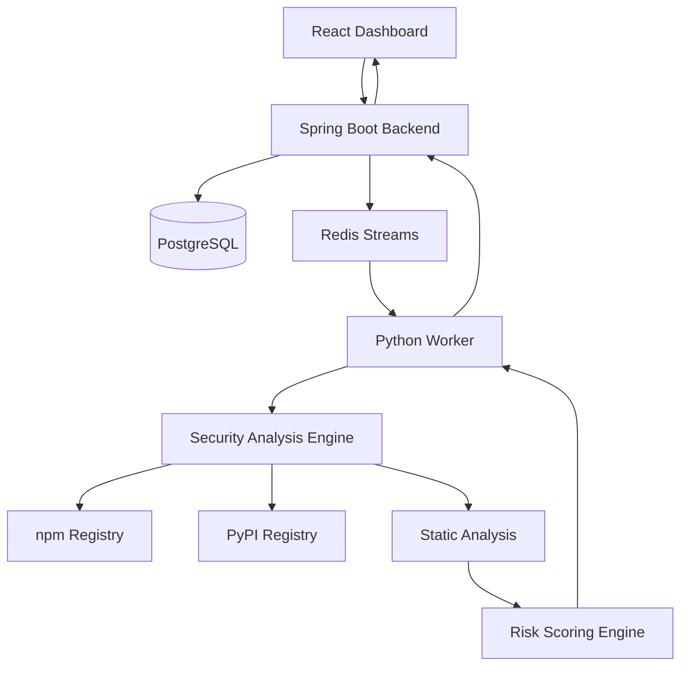

# 🛡️ PkgSentinel
### Intelligent Open-Source Supply Chain Security Platform

**Detect suspicious packages before they become a security risk.**

PkgSentinel is an intelligent supply-chain security platform designed to analyze npm and PyPI packages for suspicious behavior, potentially malicious code patterns, and software supply-chain threats.

Unlike traditional vulnerability scanners that primarily rely on known CVE databases, PkgSentinel performs static code analysis, package metadata inspection, behavioral indicator detection, and explainable risk scoring to identify potentially dangerous packages.

---

## ✨ Key Features

### 🔍 Multi-Ecosystem Package Analysis
- Supports npm and PyPI package ecosystems.
- Retrieves package metadata and downloadable distributions.
- Supports automatic latest-version resolution.
- Performs package integrity and archive safety checks.

### 🧠 Static Security Analysis
- Python AST-based analysis.
- JavaScript AST-based analysis.
- Suspicious dynamic execution detection.
- Dynamic import and module loading analysis.
- Obfuscation and high-entropy string detection.
- Typosquatting and package-name similarity detection.
- Suspicious metadata and package behavior indicators.

### ⚖️ Intelligent Risk Scoring
- Aggregates security findings into a normalized risk score.
- Applies severity and confidence-based evaluation.
- Uses diminishing returns for repeated detection rules.
- Generates explainable findings with file paths and line numbers.
- Produces risk classifications:
  - SAFE
  - SUSPICIOUS
  - MALICIOUS / BLOCK

### 📊 Security Dashboard
- Package scanning interface.
- Scan history and detailed reports.
- Risk scores and verdict visualization.
- Explainable security findings.
- Authenticated user accounts.

### ⚙️ Asynchronous Scan Processing
- Spring Boot backend orchestration.
- Redis Streams-based job processing.
- Dedicated Python security-analysis worker.
- Transactional scan lifecycle management.
- Authenticated worker callbacks and retry handling.

### 🔐 Security-Oriented Design
- Password hashing using PBKDF2.
- Database-backed authentication sessions.
- User-scoped scan authorization.
- Allowlisted registry hosts.
- DNS and private-IP protections.
- Safe package archive extraction.
- Download size restrictions.
- Package code is not executed during static analysis.

---

## 🏗️ System Architecture



### Processing Workflow

1. User submits an npm or PyPI package.
2. Backend validates the request and creates a scan job.
3. Scan job is published through Redis Streams.
4. Python worker retrieves package metadata and distribution files.
5. Security engine performs static analysis and detection.
6. Findings are processed by the risk-scoring engine.
7. Worker sends the authenticated scan result to the backend.
8. Dashboard displays the final report.

---

## 🧰 Technology Stack

| Component | Technologies |
|---|---|
| Frontend | React, TypeScript, Tailwind CSS |
| UI & Visualization | Lucide, Recharts |
| Backend | Java 21, Spring Boot 3 |
| Security Engine | Python 3.11+, FastAPI |
| Static Analysis | Python AST, JavaScript AST |
| Database | PostgreSQL |
| Message Queue | Redis Streams |
| Containerization | Docker, Docker Compose |
| Build Tools | Maven, npm |

---

## 📁 Project Structure

```text
PkgSentinel/
│
├── backend/
│   └── Spring Boot API and orchestration
│
├── frontend/
│   └── React + TypeScript dashboard
│
├── security-engine/
│   ├── engine/
│   │   ├── core/
│   │   ├── detection/
│   │   │   └── static/
│   │   ├── ingestion/
│   │   └── ...
│   └── tests/
│
├── infrastructure/
│   └── Dockerfiles and infrastructure
│
├── docker-compose.yml
│
└── README.md
```

---

## 🚀 Getting Started

### Prerequisites

- Docker Desktop
- Docker Compose
- Git

### 1. Clone the Repository

```bash
git clone https://github.com/SHREYA-03112006/PkgSentinel.git
cd PkgSentinel
```

### 2. Configure Environment

Review the environment configuration and required variables referenced by `docker-compose.yml` and the service configuration files.

Do not commit production secrets or credentials to GitHub.

### 3. Build and Start Services

```bash
docker compose up -d --build
```

### 4. Verify Containers

```bash
docker compose ps
```

Ensure the required services are running and health checks are passing.

### 5. Access the Application

| Service | URL |
|---|---|
| Frontend Dashboard | http://localhost:3000 |
| Backend Health | http://localhost:8081/api/v1/health |
| Security Engine Health | http://localhost:8000/health |

*The backend host port defaults to 8081 in the current Docker configuration.*

### Stop Services

```bash
docker compose down
```

To preserve database data, do not use `docker compose down -v` unless you intentionally want to delete the volumes.

---

## 🧪 Testing

The security engine includes automated tests covering:

- Python AST detection.
- JavaScript static analysis.
- Package ingestion and archive extraction.
- Registry metadata and version resolution.
- Entropy analysis.
- Risk scoring.
- Detection confidence and repeated-rule handling.

Run the Python test suite:

```bash
cd security-engine
pytest
```

---

## 🎯 Risk Classification

| Verdict | Meaning |
|---|---|
| SAFE | No significant suspicious indicators detected |
| SUSPICIOUS | One or more potentially risky indicators require investigation |
| MALICIOUS / BLOCK | Strong evidence of malicious behavior or high-confidence threat indicators |

**Important:** A SAFE verdict does not guarantee that a package is completely free from vulnerabilities or malicious behavior. Similarly, suspicious API usage does not automatically prove malicious intent.

PkgSentinel uses static indicators and contextual analysis to support security decisions.

---

## 🔮 Future Scope

Potential future enhancements include:

- Dynamic package execution in isolated Docker sandboxes.
- Runtime behavioral monitoring.
- Network activity and system-call analysis.
- GitHub Actions integration.
- CI/CD security enforcement.
- Expanded ecosystem support.
- Threat intelligence integration.
- Advanced package dependency graph analysis.

Dynamic sandbox execution and external CI/CD integrations are future extensions, not capabilities currently claimed as operational.

---

## 🔒 Security Disclaimer

PkgSentinel is a security research and analysis project.

It is designed to identify suspicious package characteristics through static analysis and contextual risk assessment. It is not a replacement for comprehensive security audits, runtime sandboxing, vulnerability scanners, or professional security review.

Detection results should be treated as security indicators rather than absolute proof.

---

## 👨‍💻 Author

**Shreyansh Sachan**

B.Tech – Computer Science (Data Science)

GitHub: [@SHREYA-03112006](https://github.com/SHREYA-03112006)

---

## ⭐ Support

If you find PkgSentinel interesting, consider giving the repository a star!

**Building a safer open-source ecosystem, one package at a time.** 🛡️
