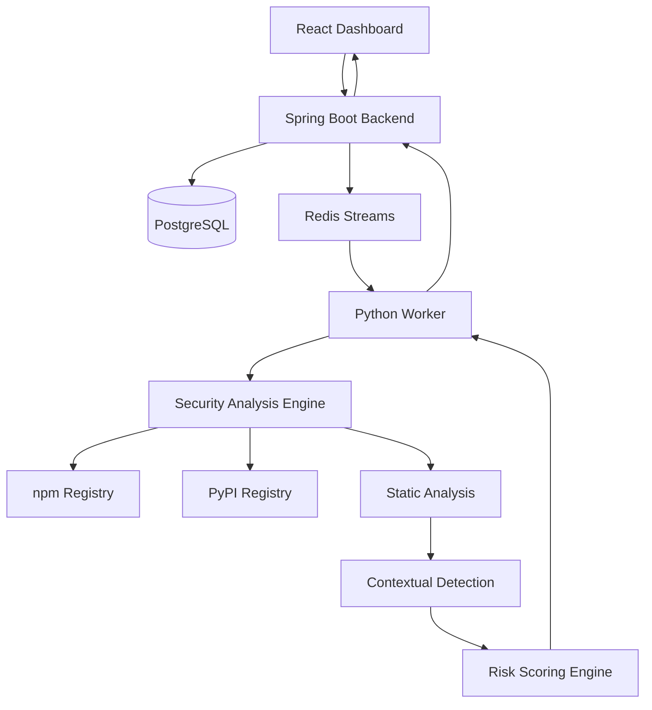

# 🛡️ PkgSentinel
### Intelligent Open-Source Supply Chain Security Platform

**Identify suspicious packages. Analyze security risks. Make informed dependency decisions.**

PkgSentinel is an intelligent software supply-chain security platform designed to analyze npm and PyPI packages for suspicious behavior, potentially malicious code patterns, and supply-chain threats.

It combines package metadata inspection, static code analysis, contextual behavior detection, and explainable risk scoring to identify potentially dangerous dependencies before they enter your development environment.

Unlike traditional vulnerability scanners that primarily depend on known CVE databases, PkgSentinel focuses on analyzing package behavior and suspicious code characteristics.

---

## ✨ Key Features

### 🔍 Multi-Ecosystem Package Analysis
- Supports npm and PyPI package ecosystems.
- Retrieves package metadata and downloadable distributions.
- Automatically resolves the latest available package version.
- Supports explicit version selection.
- Performs package integrity and archive safety checks.
- Handles invalid package names and unavailable versions.

### 🧠 Context-Aware Static Security Analysis

**Python Analysis**
- Python AST-based security analysis.
- Dynamic execution detection (`exec`, `eval`, `compile`).
- Dynamic import analysis.
- Suspicious subprocess and command execution detection.
- Environment variable and sensitive-data access analysis.
- Obfuscation and high-entropy string detection.

**JavaScript Analysis**
- JavaScript static code analysis.
- Suspicious dynamic module loading.
- Dynamic execution indicators.
- Package lifecycle script inspection.
- Suspicious code patterns.

### 🎯 Contextual Detection & False-Positive Reduction

PkgSentinel evaluates suspicious operations in context rather than treating every occurrence as malicious.

- Distinguishes ordinary subprocess usage from suspicious command execution.
- Evaluates shell execution and potentially unsafe command construction.
- Considers attacker-controlled arguments and suspicious execution patterns.
- Differentiates legitimate package functionality from potentially dangerous behavior.
- Applies contextual analysis to test files and development utilities.
- Avoids automatically classifying repeated generic operations as high-confidence threats.

### ⚖️ Explainable Risk Scoring

- Aggregates security findings into a normalized risk score.
- Uses severity and confidence-based evaluation.
- Applies diminishing returns to repeated detection rules.
- Gives greater importance to independent and corroborating indicators.
- Provides explainable findings with file paths, line numbers, and evidence.
- Produces actionable risk classifications.

### 📊 Security Dashboard
- Package scanning interface.
- Scan history and detailed reports.
- Risk scores and verdict visualization.
- Security findings with contextual evidence.
- Authenticated user accounts.
- User-scoped scan authorization.

### ⚙️ Asynchronous Scan Processing
- Spring Boot backend orchestration.
- Redis Streams-based job processing.
- Dedicated Python security-analysis worker.
- Transactional scan lifecycle management.
- Authenticated worker callbacks.
- Retry handling and asynchronous status updates.

### 🔐 Security-Oriented Design
- PBKDF2 password hashing.
- Database-backed authentication sessions.
- Registry host allowlisting.
- DNS and private-IP protections.
- Safe package archive extraction.
- Download size restrictions.
- Package code is not executed during static analysis.

---

## 🏗️ System Architecture



### Processing Workflow

1. User submits an npm or PyPI package.
2. Backend validates the request and creates a scan job.
3. Scan job is published through Redis Streams.
4. Python worker retrieves package metadata and distribution files.
5. Security engine performs static analysis and contextual detection.
6. Findings are evaluated by the risk-scoring engine.
7. Worker sends the authenticated scan result to the backend.
8. Dashboard displays the final security report.

---

## 🧰 Technology Stack

| Component | Technologies |
|---|---|
| Frontend | React, TypeScript |
| Styling | Tailwind CSS |
| UI & Visualization | Lucide, Recharts |
| Backend | Java 21, Spring Boot 3 |
| Security Engine | Python 3.11+, FastAPI |
| Static Analysis | Python AST, JavaScript analysis |
| Database | PostgreSQL |
| Message Queue | Redis Streams |
| Containerization | Docker, Docker Compose |
| Build Tools | Maven, npm |

---

## 📁 Project Structure

```text
PkgSentinel/
│
├── backend/
│   └── Spring Boot API and orchestration
│
├── frontend/
│   └── React + TypeScript dashboard
│
├── security-engine/
│   ├── engine/
│   │   ├── core/
│   │   ├── detection/
│   │   │   └── static/
│   │   ├── ingestion/
│   │   └── ...
│   │
│   └── tests/
│
├── infrastructure/
│   └── Docker and infrastructure configuration
│
├── docker-compose.yml
│
└── README.md
```

---

## 🚀 Getting Started

### Prerequisites

- Docker Desktop
- Docker Compose
- Git

### 1. Clone the Repository

```bash
git clone https://github.com/SHREYA-03112006/PkgSentinel.git
cd PkgSentinel
```

### 2. Configure Environment

Review the environment configuration and required variables referenced by `docker-compose.yml` and individual service configuration files.

Do not commit production secrets or credentials to GitHub.

### 3. Build and Start Services

```bash
docker compose up -d --build
```

### 4. Verify Containers

```bash
docker compose ps
```

Ensure the required services are running and their health checks are passing.

### 5. Access the Application

| Service | URL |
|---|---|
| Frontend Dashboard | http://localhost:3000 |
| Backend Health | http://localhost:8081/api/v1/health |
| Security Engine Health | http://localhost:8000/health |

*The backend host port defaults to 8081 in the current Docker configuration.*

### Stop Services

```bash
docker compose down
```

To preserve database data, avoid using `docker compose down -v` unless you intentionally want to delete the database volumes.

---

## 🧪 Testing

PkgSentinel includes automated tests for its security-analysis components.

Test coverage includes:

- Python AST-based detection.
- JavaScript static analysis.
- Dynamic execution indicators.
- Subprocess detection and contextual classification.
- Package ingestion and archive extraction.
- Registry metadata and version resolution.
- Entropy analysis.
- Risk scoring and repeated-rule aggregation.
- Detection confidence and regression scenarios.

### Run Python Tests

```bash
cd security-engine
pytest
```

---

## 🎯 Risk Classification

| Verdict | Meaning |
|---|---|
| SAFE | No significant suspicious indicators detected |
| SUSPICIOUS | Potentially risky indicators require investigation |
| MALICIOUS / BLOCK | Strong evidence of malicious behavior or high-confidence threat indicators |

Risk scores are based on detected evidence, severity, confidence, and contextual analysis.

A high score does not automatically prove malicious intent, and a low score does not guarantee that a package is completely safe.

---

## 🔬 Detection Philosophy

PkgSentinel aims to balance two important security objectives:

**1. Reduce False Positives**

Legitimate operations such as subprocess calls, dynamic imports, environment checks, and package testing should not automatically be treated as malicious.

**2. Preserve True-Positive Detection**

Suspicious execution patterns, unsafe command construction, obfuscated payloads, and corroborating threat indicators should retain appropriate severity.

The goal is not simply to maximize risk scores, but to generate meaningful and explainable security findings.

---

## 🔮 Future Scope

Potential future enhancements include:

- Dynamic package execution in isolated Docker sandboxes.
- Runtime behavioral monitoring.
- Network activity and system-call analysis.
- GitHub Actions integration.
- CI/CD security enforcement.
- Expanded ecosystem support.
- Threat intelligence integration.
- Advanced dependency graph analysis.
- Automated security benchmark evaluation.

Dynamic sandbox execution and external CI/CD integrations are planned extensions, not capabilities currently claimed as operational.

---

## 🔒 Security Disclaimer

PkgSentinel is a security research and analysis project.

It identifies suspicious package characteristics through static analysis and contextual risk assessment. It is not a replacement for comprehensive security audits, runtime sandboxing, vulnerability scanners, or professional security reviews.

Detection results should be treated as security indicators rather than absolute proof.

A SAFE verdict does not guarantee that a package is free from vulnerabilities or malicious behavior.

---

## 👨‍💻 Author

**Shreyansh Sachan**

B.Tech – Computer Science (Data Science)

GitHub: [@SHREYA-03112006](https://github.com/SHREYA-03112006)

**Repository:** [github.com/SHREYA-03112006/PkgSentinel](https://github.com/SHREYA-03112006/PkgSentinel)

---

## ⭐ Support

If you find PkgSentinel interesting, consider giving the repository a star!

**Building a safer open-source ecosystem, one package at a time.** 🛡️
